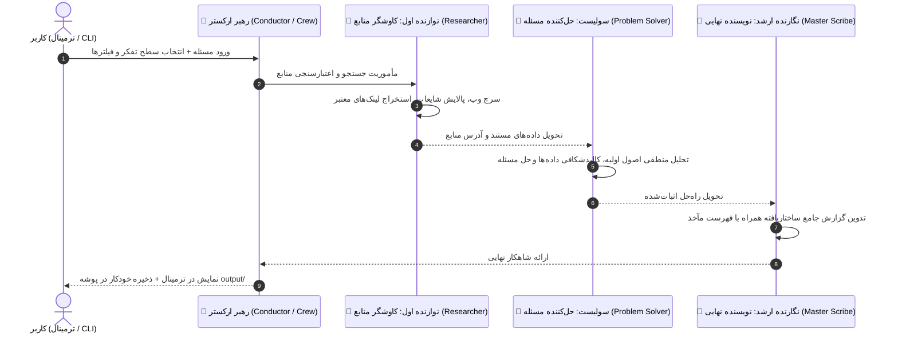

# 🎼 AI Orchestra (ارکستر هوش مصنوعی)

[](https://www.python.org/downloads/)
[](https://crewai.com)
[](LICENSE)
[]()

> **یک ارکستر چندعاملی هوش مصنوعی بر پایه CrewAI برای کاوش منابع معتبر، حل استدلالی مسائل و نگارش گزارش‌های ساختاریافته.**
> 
> *An intelligent multi-agent symphonic orchestra powered by CrewAI: specialized AI agents collaborating in harmony to discover authoritative sources, reason through complex challenges, and author publication-ready executive dossiers.*

---

## 📖 این پروژه چیست؟ (What is AI Orchestra?)

در یک ارکستر سمفونیک، هر نوازنده ساز تخصصی خود را می‌نوازد و همه تحت هدایت رهبر ارکستر (Conductor) یک شاهکار هماهنگ خلق می‌کنند. این پروژه نیز صورت مسئله کاربر را به عنوان یک «قطعه موسیقی» دریافت کرده و با همکاری ۳ مأمور تخصصی آن را به ثمر می‌رساند:



### 👥 نقش‌های ارکستر (The Musicians):
1. **🎻 ویولن اول / کاوشگر منابع (First Violin - Researcher):**
   - ماموریت: کاوش در پهنه وب، فیلتر کردن ادعاهای غیررسمی، استخراج فکت‌ها و مقالات علمی، و جمع‌آوری لینک‌های معتبر.
   - مجهز به موتور سرچ چندلایه: Google Serper / Tavily / فال‌بک رایگان DuckDuckGo و دانشنامه‌ها.
2. **🎹 سولیست / حل‌کننده مسئله (Piano Soloist - Problem Solver):**
   - ماموریت: تفکر عمیق گام‌به‌گام بر اساس اصول اولیه (First Principles)، تحلیل نقادانه شواهد و فرموله‌کردن راه‌حل نهایی بدون حدس و گمان.
3. **🎺 شیپورچی و نگارنده ارشد (Master Scribe - Writer):**
   - ماموریت: تبدیل پاسخ تحلیلی و ارجاعات مستند به یک گزارش نهایی فوق‌العاده شکیل، منسجم، دارای چکیده اجرایی و جدول مآخذ.
4. **🎼 رهبر ارکستر (Maestro / Conductor):**
   - مدیریت چرخه اجرای ترتیبی (Sequential)، زنجیره‌سازی کانتکست بین نوازندگان و مدیریت خطاهای احتمالی.

---

## ✨ ویژگی‌های کلیدی نسخه ۲.۱ (Key Features)

* **🦙 پشتیبانی کامل از مدل‌های محلی Ollama (آفلاین، نامحدود و ۱۰۰٪ رایگان):**
  * **Auto-Detection هوشمند:** شناسایی خودکار سرویس Ollama و اسکن مدل‌های دانلودشده روی سیستم (مانند `qwen2.5-coder`, `llama3.2` و...).
  * **ارکستر تمام‌لوکال (Local Mode):** اجرای تمام مراحل بدون مصرف حتی یک توکن و بدون نیاز به اینترنت یا کلید API.
  * **ارکستر هیبریدی (Hybrid Mode):** ترکیب آزادانه مدل‌های محلی و ابری (مثلاً سرچ و نگارش با Ollama، و استدلال با Gemini).
* **🎚️ انتخاب رده و قدرت مدل (Model Tiers):** پشتیبانی از مدل‌های سبک و کم‌مصرف (`Flash-Lite`)، مدل‌های متوازن (`Flash`)، مدل‌های سنگین و استدلالی (`Pro`) و مدل‌های دلخواه برای ارائه‌دهندگان مختلف (Google Gemini, OpenAI, Groq, Ollama).
* **🧠 سطوح تفکر ارکستر (Thinking Depth Levels):**
  * ⚡ **Fast (سریع):** پاسخ مستقیم، استخراج سریع ۳ منبع، خلاصه فشرده ~۳۰۰ کلمه‌ای.
  * ⚖️ **Balanced (متوازن):** تحلیل گام‌به‌گام استاندارد و گزارش کامل.
  * 🔬 **Deep / Exhaustive (عمیق و جامع):** پژوهش موشکافانه آکادمیک، راستی‌آزمایی متقابل فرضیات و پرونده تحلیلی عمیق.
* **🎯 فیلترهای مرحله‌ای:**
  * **فیلتر دامنه منابع:** محدودسازی جستجو به دامنه‌های خاص (مانند `.com`، `.edu`، `nature.com`).
  * **فیلتر زبان منابع:** واکشی منابع به یک زبان خاص (مثلاً پرتغالی `pt`، انگلیسی `en` یا فارسی `fa`).
  * **زبان خروجی گزارش:** انتخاب زبان نگارش گزارش نهایی.
* **🛡️ امنیت Zero-Key:** کلیدهای API کاربر در گیت ذخیره نمی‌شوند و در حافظه سیستم یا `.env` محلی کاربر محفوظ می‌مانند.

---

## ⚠️ سلب مسئولیت و وضعیت پروژه (Disclaimer & Known Issues)

> [!WARNING]
> **این پروژه در فاز MVP (نمونه اولیه تجربی) قرار دارد و ممکن است با باگ‌ها یا محدودیت‌هایی همراه باشد:**
> 1. **سقف درخواست APIهای رایگان (Rate Limits):** حساب‌های رایگان (Free Tier) سرویس‌هایی مثل گوگل جمینای سقف ۱۵ درخواست در دقیقه دارند. اگر در حالت Deep پشت سر هم کوئری بفرستید، ممکن است به خطای ۴۲۹ بربخورید.
> 2. **پایداری سرچ وب رایگان:** ابزار فال‌بک رایگان وب (DuckDuckGo) به دلیل تغییرات ساختار صفحات ممکن است گهگاه با کندی یا مسدودی شبکه مواجه شود؛ برای پروژه‌های تجاری پایدار استفاده از کلید Serper یا Tavily توصیه می‌شود.
> 3. **تغییر نام مداوم مدل‌ها توسط ارائه‌دهندگان:** ارائه‌دهندگانی مانند گوگل مرتباً مدل‌های قدیمی را بازنشسته می‌کنند (مثلاً انتقال از ۱.۵ و ۲.۰ به ۳.۸). برنامه دارای لایه Auto-Upgrade است اما ممکن است در آینده نیاز به به‌روزرسانی مدل‌ها داشته باشد.
> 
> اگر باگی پیدا کردید، خوشحال می‌شویم از طریق **Issues** یا ارسال **Pull Request** آن را با ما در میان بگذارید!

---

## 📦 نیازمندی‌ها و کتابخانه‌ها (Requirements)

پروژه به **پایتون نسخه 3.10 یا بالاتر** نیاز دارد.

کتابخانه‌های اصلی به کار رفته (لیست کامل در `requirements.txt`):
* `crewai` و `crewai-tools`: فریم‌ورک اصلی ارکستراسیون ایجنت‌ها
* `google-genai`: کتابخانه رسمی ارتباط با مدل‌های Google Gemini
* `rich`: رندر رابط ترمینالی رنگی، جداول، پنل‌ها و لودینگ‌های زنده
* `python-dotenv`: مدیریت متغیرهای محیطی و فایل‌های کانفیگ
* `requests` و `beautifulsoup4` و `lxml`: واکشی و پارس صفحات وب در ابزار جستجو

---

## 🚀 راهنمای نصب و راه‌اندازی (Quick Start)

### ۱. کلون کردن مخزن
```bash
git clone https://github.com/your-username/crewAI-orchestra.git
cd crewAI-orchestra
```

### ۲. ساخت و فعال‌سازی محیط مجازی
```bash
# ویندوز (PowerShell):
python -m venv .venv
.\.venv\Scripts\Activate.ps1

# لینوکس یا مک:
python3 -m venv .venv
source .venv/bin/activate
```

### ۳. نصب وابستگی‌ها
```bash
pip install -r requirements.txt
```

### ۴. اجرای برنامه

#### روش آسان (ویندوز):
کافیست فایل **`run.bat`** را دابل‌کلیک کنید یا در ترمینال بزنید:
```cmd
run.bat
```

#### روش استاندارد پایتون:
```bash
python main.py
```

در اولین اجرا، جادوگر تعاملی برنامه کلید API و مدل مدنظر شما را می‌پرسد (می‌توانید کلید رایگان Google Gemini، OpenAI یا Groq خود را وارد کنید).

#### اجرای تک‌دستوری (One-shot Mode):
```bash
python main.py --query "علل پیدایش سیاه‌چاله‌ها چیست؟" --depth fast
```

---

## 📁 ساختار فایل‌های پروژه (Project Structure)

```text
├── tools/
│   ├── __init__.py
│   └── search_tool.py    # ابزار هوشمند سرچ وب با فیلتر دامنه و زبان
├── agents.py             # تعریف پرسونای ۳ مأمور ارکستر و LLMها
├── tasks.py              # تعریف تسک‌ها، سطوح تفکر و زنجیره‌سازی کانتکست
├── orchestra.py          # کلاس رهبر ارکستر (AIOrchestra) و پایپ‌لاین CrewAI
├── config.py             # ویزارد تنظیمات تعاملی، رده‌های مدل و عمق تفکر
├── main.py               # نقطه ورود اصلی ترمینال
├── run.bat               # لانچر وان‌کلیک برای ویندوز
├── requirements.txt      # لیست کتابخانه‌های مورد نیاز
├── .env.example          # نمونه قالب کلیدهای محیطی
├── .gitignore            # نادیده‌گرفتن فایل‌های حساس و سکرت‌ها
└── README.md             # مستندات کامل پروژه
```

---

## 🤝 مشارکت (Contributing)
هرگونه پیشنهاد، رفع باگ و ارتقا با آغوش باز پذیرفته می‌شود. برای مشارکت:
1. مخزن را فورک (Fork) کنید.
2. یک برنچ جدید برای تغییرات خود بسازید (`git checkout -b feature/amazing-feature`).
3. تغییرات را کامیت کنید (`git commit -m 'Add some feature'`).
4. به برنچ خود پوش کنید (`git push origin feature/amazing-feature`).
5. یک **Pull Request** ارسال نمایید.

---

## 📜 لایسنس
این پروژه تحت لایسنس **MIT** منتشر شده است.
